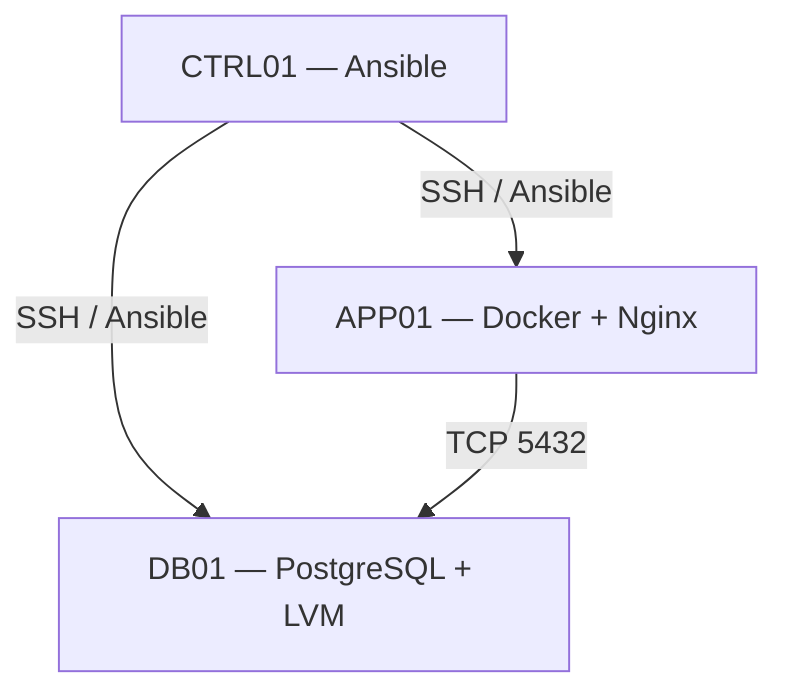

# NexaOps — Enterprise Linux Infrastructure & Automation

A hands-on, multi-server Linux infrastructure project built using **Red Hat Enterprise Linux 9, Rocky Linux 9, Ansible, Docker, Nginx, PostgreSQL, and LVM**.

The project simulates a small enterprise environment with centralized infrastructure administration, automated configuration management, containerized web services, secure database connectivity, and backup and recovery procedures.

## Project Overview

NexaOps demonstrates practical Linux System Administration skills through the deployment and management of three virtual servers using VMware Workstation.

The infrastructure is designed around a fictional internal Helpdesk environment, with separate responsibilities for administration, application hosting, and database services.

## Infrastructure Architecture

| Server | Operating System | Role | Private IP |
|---|---|---|---|
| CTRL01 | Rocky Linux 9 | Ansible Control Node | 192.168.60.10 |
| APP01 | RHEL 9.8 | Docker & Nginx Application Server | 192.168.60.20 |
| DB01 | RHEL 9.8 | PostgreSQL Database & LVM Storage | 192.168.60.30 |

### Network Design

**VMnet8 — NAT Network**
- Subnet: `192.168.67.0/24`
- DHCP addressing
- Internet access and package management

**VMnet5 — Private Host-only Network**
- Subnet: `192.168.60.0/24`
- Static IP addressing
- Internal communication between infrastructure servers
- No default gateway on the private interfaces

  ## Network Architecture



## Technologies Used

| Category | Technologies |
|---|---|
| Operating Systems | RHEL 9.8, Rocky Linux 9 |
| Virtualization | VMware Workstation |
| Automation | Ansible, YAML, Jinja2 |
| Containers | Docker Engine, Docker Compose |
| Web Server | Nginx |
| Database | PostgreSQL 13 |
| Storage | LVM, XFS |
| Security | SSH, SELinux, Firewalld |
| Scheduling | Cron |
| Time Synchronization | Chrony / NTP |
| Version Control | Git, GitHub |

## Key Implementations

### 1. Linux Infrastructure Administration

- Provisioned three Linux virtual machines.
- Configured hostnames, network interfaces, routing, and DNS.
- Established communication over a dedicated private network.
- Configured administrative users and SSH public-key authentication.
- Managed system services using systemd.

### 2. Ansible Automation

Configured CTRL01 as the centralized Ansible Control Node.

Implemented reusable Ansible Roles and Playbooks for:

- Common Linux administration packages
- Docker Engine installation and configuration
- Nginx deployment through Docker Compose
- PostgreSQL package installation
- Remote server configuration and administration

Verified Ansible connectivity across all three servers and tested repeatable, idempotent execution of selected Playbooks.

### 3. Docker & Nginx

Deployed an Nginx container on APP01 using Docker Compose and Ansible.

- Container: `nexaops-nginx`
- Host port: `8080`
- Container port: `80`
- Private binding: `192.168.60.20:8080`
- Application directory: `/opt/nexaops/nginx`

Used Jinja2 templates to generate deployment configuration and application content.

Configured the application content as a read-only Docker bind mount with SELinux labeling.

### 4. PostgreSQL Database Administration

Installed and configured PostgreSQL on DB01.

- Database: `helpdesk_db`
- Application role: `helpdesk_app`
- TCP port: `5432`
- Private database IP: `192.168.60.30`

Configured PostgreSQL to accept authenticated connections from APP01 through the private network.

Used SCRAM-SHA-256 authentication and Firewalld rules to restrict database connectivity.

### 5. LVM Storage Management

Configured dedicated database storage using a separate 15 GB virtual disk.

- Physical Volume: `/dev/nvme0n2`
- Volume Group: `vg_postgres`
- Logical Volume: `lv_data`
- Logical Volume Size: 12 GB
- Filesystem: XFS
- Mount Point: `/var/lib/pgsql/data`

Configured persistent mounting through `/etc/fstab` and applied PostgreSQL-specific SELinux file contexts.

### 6. Linux Security

Implemented security controls including:

- SSH public-key authentication
- Disabled SSH password authentication on hardened hosts
- Disabled direct root SSH login
- SELinux Enforcing mode
- Firewalld network access rules
- Private network service bindings
- Restricted PostgreSQL access
- Linux users and groups administration

### 7. Chrony & Cron

Configured Chrony for NTP time synchronization.

Implemented a scheduled PostgreSQL service health check using a Bash script and Cron.

The script records PostgreSQL service status in a log file and writes a system log entry if the service is unavailable.

### 8. PostgreSQL Backup & Restore

Performed a practical backup and recovery test using `pg_dump` and `pg_restore`.

**Backup:**
- Created a PostgreSQL custom-format backup.
- Verified backup archive contents.
- Included a test table named `support_tickets` with three records.

**Restore:**
- Created a separate database named `helpdesk_restore_test`.
- Restored the database backup.
- Verified the restored table and records.
- Compared record counts between the original and restored databases.

**Result: Successful backup and restore validation — 3 records recovered.**

## Project Structure

```text
nexaops-ansible/
├── ansible.cfg
├── inventories/
│   └── lab/
│       └── hosts.ini
├── playbooks/
│   ├── system-info.yml
│   ├── install-admin-tools.yml
│   ├── common-setup.yml
│   ├── db01-setup.yml
│   ├── docker-setup.yml
│   ├── nginx-deploy.yml
│   └── postgresql-setup.yml
├── roles/
│   ├── common/
│   ├── docker/
│   ├── nginx/
│   └── postgresql/
└── docs/
    └── network-architecture.svg
```

The `docs/` directory is intended for the architecture diagram and supporting documentation.

## Validation & Testing

| Test | Result |
|---|---|
| Ansible connectivity to CTRL01, APP01, and DB01 | Passed |
| Docker and Nginx service validation | Completed |
| PostgreSQL service and storage checks | Completed |
| APP01 to DB01 PostgreSQL authentication | Passed |
| Ansible idempotency for selected roles | Passed |
| PostgreSQL backup archive inspection | Passed |
| PostgreSQL database restoration | Passed |
| Original vs. restored record count | 3 / 3 |

## Scope & Limitations

This project is a VMware-based enterprise-style lab, not a production deployment.

- Nginx serves a demonstration web page rather than a fully implemented Helpdesk application.
- PostgreSQL storage and database configuration include manual administration steps.
- Monitoring with Prometheus and Grafana is outside the final project scope.
- Automated database backup scheduling, retention, and off-host backups are not implemented.
- Some security configurations require additional comprehensive validation before production use.

## Skills Demonstrated

Linux System Administration • RHEL • Rocky Linux • Ansible • Infrastructure Automation • Docker • Docker Compose • Nginx • PostgreSQL • LVM • XFS • SSH • SELinux • Firewalld • Chrony • Cron • Bash Scripting • Backup & Recovery • Git

## Project Status

**Core infrastructure implementation and functional validation completed.**

## Documentation

Detailed project documentation:

- [Infrastructure Documentation](docs/infrastructure.md)
- [Validation & Testing](docs/validation.md)

The project demonstrates practical administration of a multi-server Linux environment, combining automation, container management, database administration, storage management, security, and disaster recovery testing.
