# NexaOps — Infrastructure Validation & Testing

## 1. Overview

This document describes the validation procedures performed in the NexaOps Linux Infrastructure Lab.

The purpose is to demonstrate operational testing of Ansible automation, Docker, Nginx, PostgreSQL, LVM storage, security controls, and database recovery.

**Environment:** VMware Workstation, Rocky Linux 9, RHEL 9.8.

## 2. Ansible Connectivity — CTRL01

**Command:**

```bash
cd /home/nexaadmin/nexaops-ansible
ansible all -m ansible.builtin.ping -K
```

**Observed result:** CTRL01, APP01, and DB01 returned successful Ansible ping responses.

**Status:** PASS

## 3. Docker & Nginx — APP01

**Validation commands:**

```bash
sudo systemctl is-active docker
sudo docker ps
curl -I http://192.168.60.20:8080
```

**Checks:**
- Docker daemon is running.
- The `nexaops-nginx` container is running.
- The web service responds over the private network.

**Status:** Deployed and verified.

## 4. PostgreSQL Service — DB01

**Validation commands:**

```bash
sudo systemctl is-active postgresql
sudo -u postgres psql -d helpdesk_db -c "SELECT current_database();"
sudo ss -lntp | grep 5432
```

**Checks:**
- PostgreSQL service is active.
- The `helpdesk_db` database is accessible locally.
- PostgreSQL listens on TCP port 5432.

**Status:** PostgreSQL installation and database configuration completed.

## 5. PostgreSQL Network Access — APP01

**Validation command:**

```bash
psql -h 192.168.60.30 -U helpdesk_app -d helpdesk_db
```

**Observed result:** Successful remote database authentication from APP01 to DB01.

**Status:** PASS

## 6. LVM Storage — DB01

**Validation commands:**

```bash
sudo pvs
sudo vgs
sudo lvs
findmnt /var/lib/pgsql/data
sudo df -hT /var/lib/pgsql/data
```

**Configured storage:**

| Component | Value |
|---|---|
| Physical Volume | `/dev/nvme0n2` |
| Volume Group | `vg_postgres` |
| Logical Volume | `lv_data` |
| LV Size | 12 GB |
| Filesystem | XFS |
| Mount Point | `/var/lib/pgsql/data` |
| Available VG Space | Approximately 3 GB |

**Observed result:** The dedicated PostgreSQL logical volume is mounted successfully with the XFS filesystem.

**Status:** PASS

## 7. SELinux & Firewalld

**Validation commands:**

```bash
getenforce
sudo systemctl is-active firewalld
sudo firewall-cmd --list-all
```

On DB01, inspect the database access rule:

```bash
sudo firewall-cmd --list-rich-rules
```

**Checks:**
- SELinux reports `Enforcing`.
- Firewalld is active.
- PostgreSQL access is restricted to the approved application server.

**Status:** Security controls configured; full rule inspection recommended.

## 8. Chrony & Cron

**Validation commands:**

```bash
chronyc tracking
systemctl is-active chronyd
```

On DB01:

```bash
sudo crontab -l
sudo cat /usr/local/bin/check-postgresql.sh
sudo tail /var/log/postgresql-health.log
```

**Checks:**
- Chrony is operational.
- PostgreSQL health-check scheduling is configured.
- The health-check script writes log entries.

**Status:** Chrony and scheduled health-check configuration completed.

## 9. PostgreSQL Backup & Restore — DB01

A PostgreSQL custom-format backup was created using `pg_dump`.

**Backup file:**

```text
/var/backups/nexaops/postgresql/helpdesk_db.dump
```

**Backup inspection:**

```bash
sudo -u postgres pg_restore -l /var/backups/nexaops/postgresql/helpdesk_db.dump
```

The backup was restored to a separate database named `helpdesk_restore_test`.

### Data Recovery Verification

**Commands:**

```bash
sudo -u postgres psql -d helpdesk_db -c "SELECT COUNT(*) FROM support_tickets;"
sudo -u postgres psql -d helpdesk_restore_test -c "SELECT COUNT(*) FROM support_tickets;"
```

| Database | Record Count |
|---|---:|
| `helpdesk_db` | 3 |
| `helpdesk_restore_test` | 3 |

**Observed result:** All three test records were successfully recovered.

**Status:** PASS

## 10. Validation Summary

| Component | Result |
|---|---|
| Ansible connectivity | PASS |
| Docker / Nginx deployment | Verified |
| PostgreSQL service | Verified |
| PostgreSQL remote authentication | PASS |
| LVM storage provisioning | PASS |
| SELinux / Firewalld configuration | Completed |
| Chrony / Cron configuration | Completed |
| PostgreSQL backup and restore | PASS |
| Docker private IP binding | PASS |

## 11. Evidence

The following screenshots provide evidence of the infrastructure configuration, automation, and operational testing.

### SSH Key Authentication

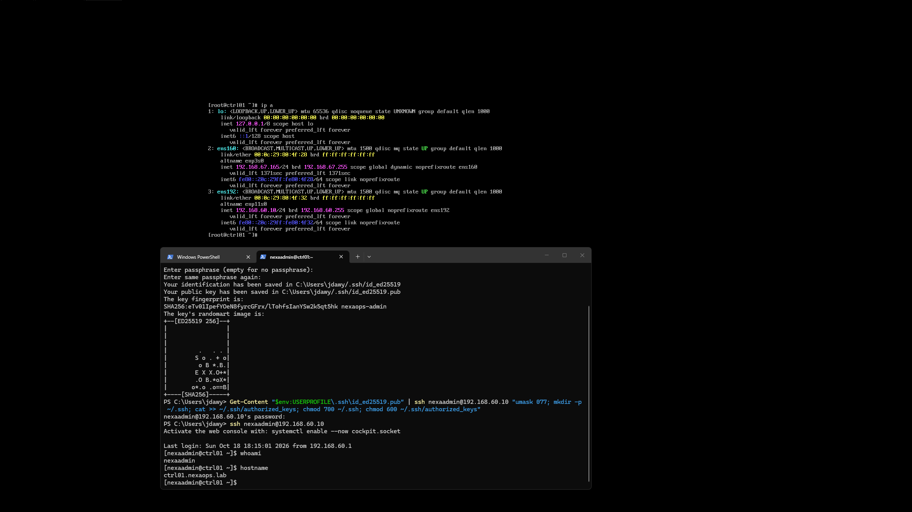

### SSH Hardening

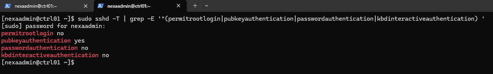

### NTP Synchronization

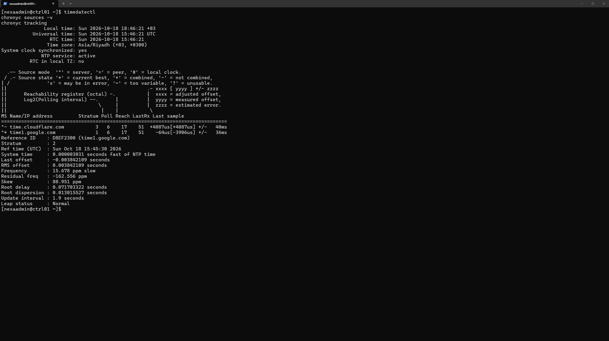

### Ansible Remote Connectivity

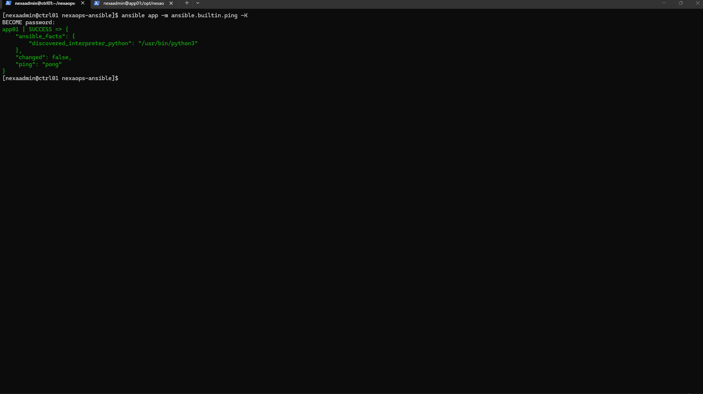

### Automated Docker Deployment

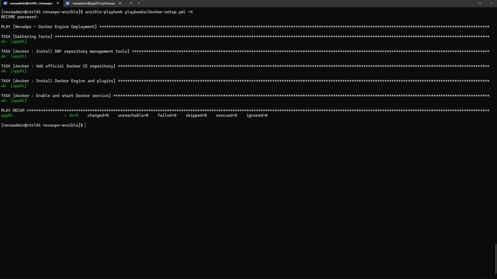

### Docker and Nginx Verification

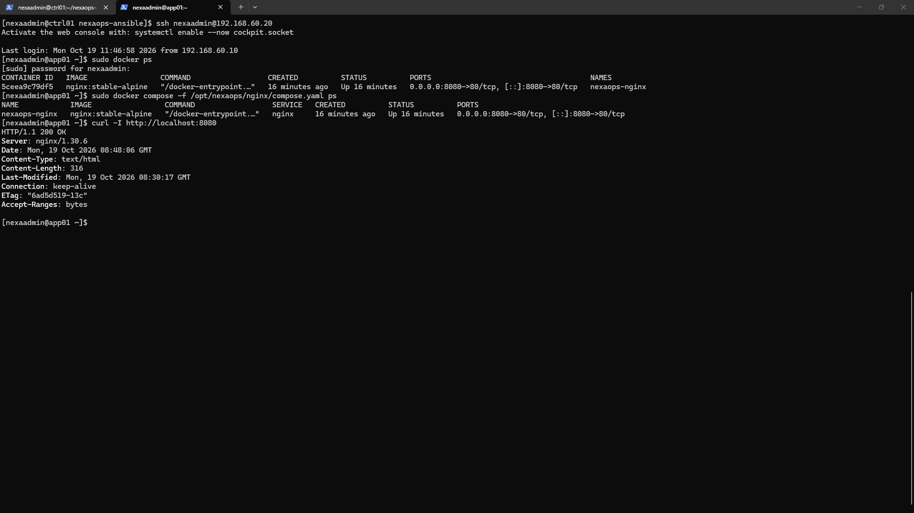

### HTTP Connectivity

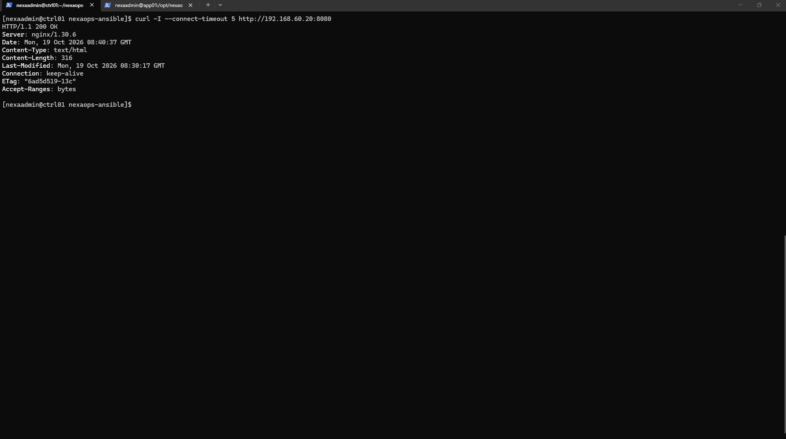

### Automated Nginx Deployment

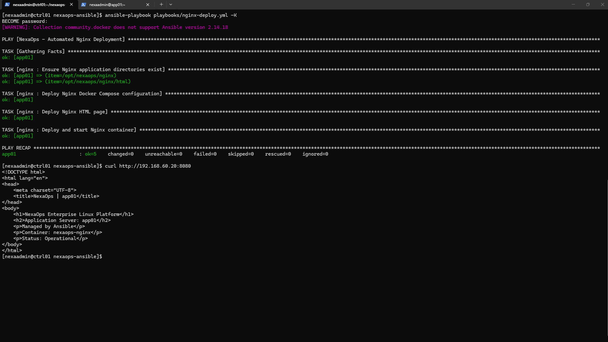

### Ansible Idempotency

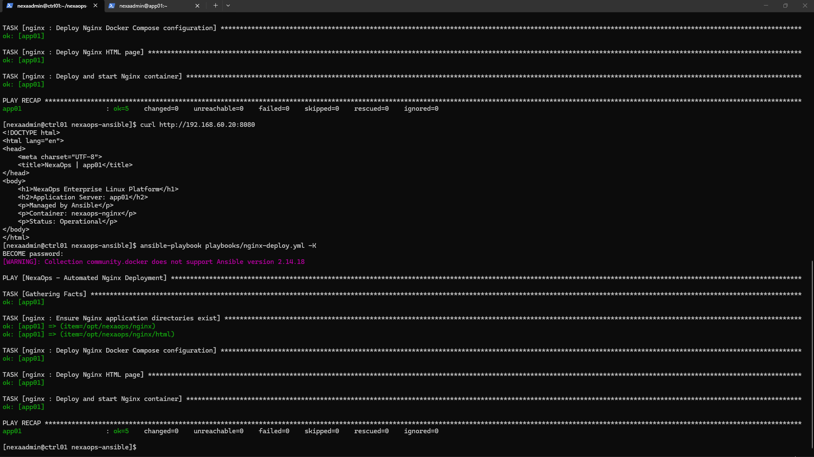

## 12. Database Server Evidence

### DB01 — LVM Storage

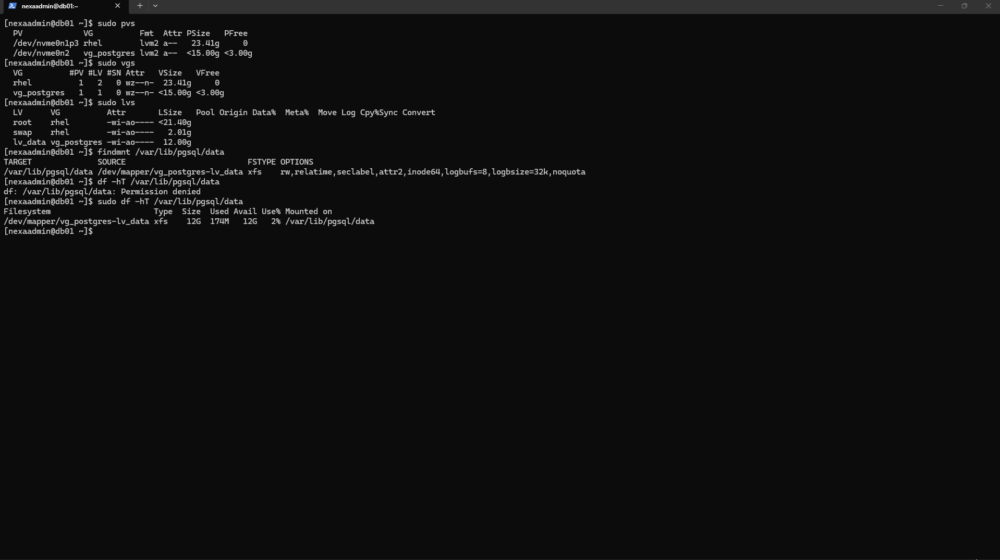

### DB01 — PostgreSQL Service

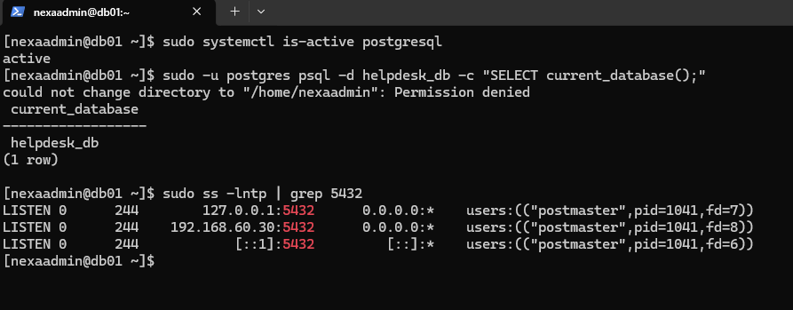

### DB01 — PostgreSQL Backup and Restore

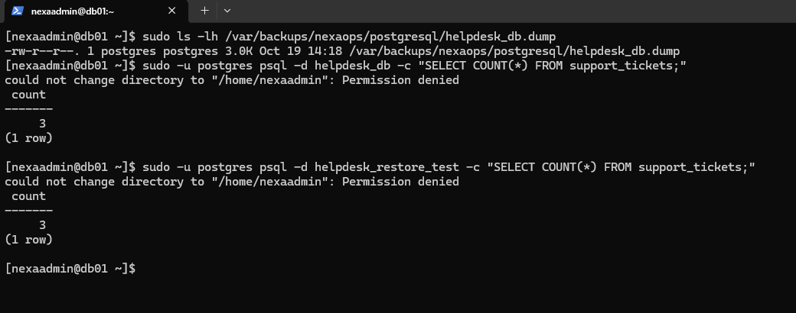

## 13. Docker Network Binding Verification — APP01

The Nginx container is bound to the APP01 private IP address `192.168.60.20` on TCP port `8080`, rather than all host interfaces.

**Docker Compose configuration:**

```yaml
services:
  nginx:
    image: "nginx:stable-alpine"
    container_name: "nexaops-nginx"
    restart: unless-stopped
    ports:
      - "192.168.60.20:8080:80"
    volumes:
      - ./html:/usr/share/nginx/html:ro,Z
```

**Validation command:**

```bash
sudo docker port nexaops-nginx
```

**Observed output:**

```text
80/tcp -> 192.168.60.20:8080
```

**Status:** PASS


## 14. Conclusion

The NexaOps lab demonstrates practical Linux infrastructure operations across three virtual servers.

The project includes:

- Centralized Linux administration using Ansible.
- SSH authentication and security hardening.
- Automated Docker and Nginx deployment.
- PostgreSQL database configuration and remote connectivity.
- Dedicated PostgreSQL storage using LVM and XFS.
- SELinux and Firewalld security controls.
- Chrony time synchronization and scheduled health checks.
- PostgreSQL backup and recovery validation.
- Private network service binding verification.

Successful Ansible connectivity, application-to-database authentication, dedicated storage validation, and PostgreSQL backup restoration provide functional evidence of key infrastructure capabilities.

The NexaOps project serves as a practical portfolio demonstration for Linux System Administrator and junior infrastructure engineering positions.
